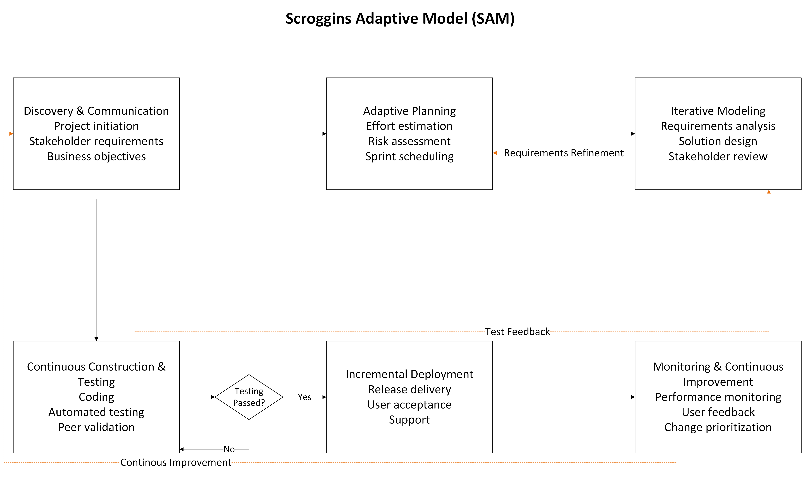
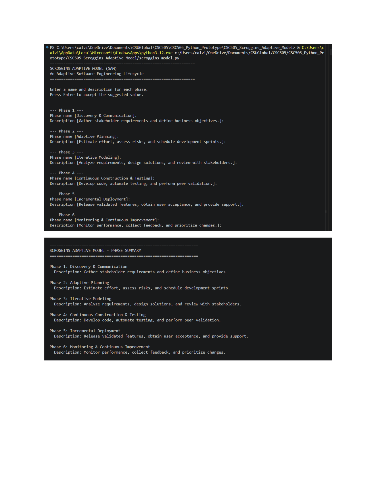
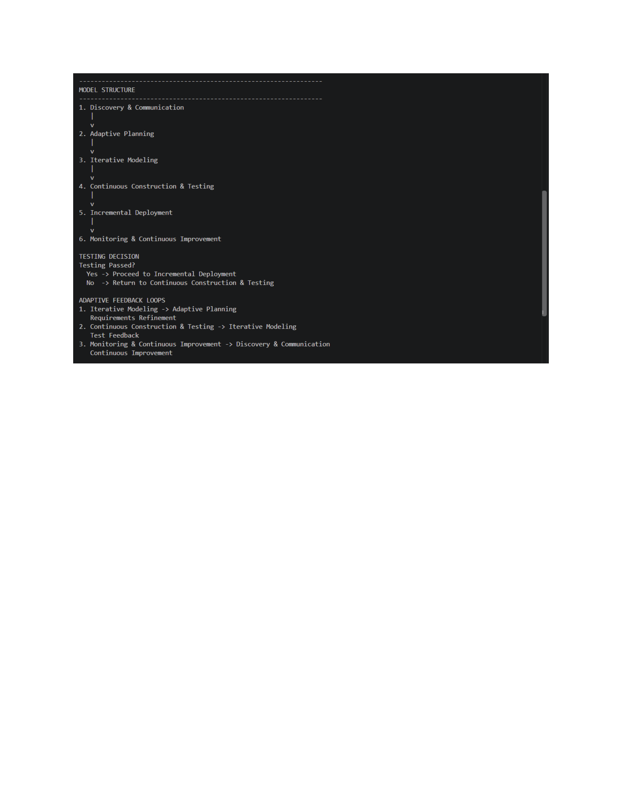

# Scroggins Adaptive Model (SAM)

**CSC505 – Principles of Software Engineering**

## Project Overview

The Scroggins Adaptive Model (SAM) is a modernized software development lifecycle model designed to address limitations of the traditional Waterfall Model. It combines structured development phases with Agile principles, DevOps practices, continuous testing, and stakeholder feedback.

The model maintains a defined development process while allowing teams to revisit earlier phases as requirements change or new issues emerge.

## Limitations of the Waterfall Model

The traditional Waterfall Model has several limitations:

- **Limited flexibility:** Changes to requirements can be difficult to incorporate after development begins.
- **Late testing:** Problems may not be identified until significant development work is complete.
- **Delayed stakeholder feedback:** Users may not evaluate working software until late in the lifecycle.
- **Sequential dependencies:** Delays or changes in one phase can affect subsequent phases.

## Scroggins Adaptive Model Phases

1. **Discovery & Communication:** Gather stakeholder requirements and define business objectives.
2. **Adaptive Planning:** Estimate effort, assess risks, and schedule development sprints.
3. **Iterative Modeling:** Analyze requirements, design solutions, and review with stakeholders.
4. **Continuous Construction & Testing:** Develop code, automate testing, and perform peer validation.
5. **Incremental Deployment:** Release validated features, obtain user acceptance, and provide support.
6. **Monitoring & Continuous Improvement:** Monitor performance, collect feedback, and prioritize changes.

## Testing Decision

Before deployment, SAM includes a **Testing Passed?** decision point.

- **Yes:** Proceed to Incremental Deployment.
- **No:** Return to Continuous Construction & Testing for corrections and retesting.

## Adaptive Feedback Loops

SAM includes three feedback mechanisms:

1. **Requirements Refinement:** Iterative Modeling → Adaptive Planning.
2. **Test Feedback:** Continuous Construction & Testing → Iterative Modeling.
3. **Continuous Improvement:** Monitoring & Continuous Improvement → Discovery & Communication.

These loops allow the development process to respond to changing requirements, testing results, and user feedback.

## UML-Style Process Diagram



The diagram was created using Microsoft Visio and illustrates the six development phases, testing decision, and feedback loops.

## Python Implementation

The Python program allows users to enter or accept suggested phase names and descriptions. It then generates a formatted summary of the model, including its phases, testing decision, and feedback mechanisms.

**Requirements:** Python 3.12 or another compatible Python 3 version. No third-party packages are required.

### Running the Program

```bash
python scroggins_model.py
```

Follow the prompts to enter the phase names and descriptions. Press Enter to accept the suggested values.

## Successful Execution

The following screenshots demonstrate successful execution of the Python program.





## Practical Application

SAM is particularly useful for business intelligence and data analytics projects where stakeholder priorities, reporting requirements, and data structures frequently change.

For example, a change to a SharePoint data source can affect downstream Power BI reports. SAM provides a structured approach for reviewing requirements, updating models, validating functionality, and incorporating stakeholder feedback.

## Reference

Pressman, R. S., & Maxim, B. R. (2020). *Software engineering: A practitioner's approach* (9th ed.). McGraw-Hill Education.
